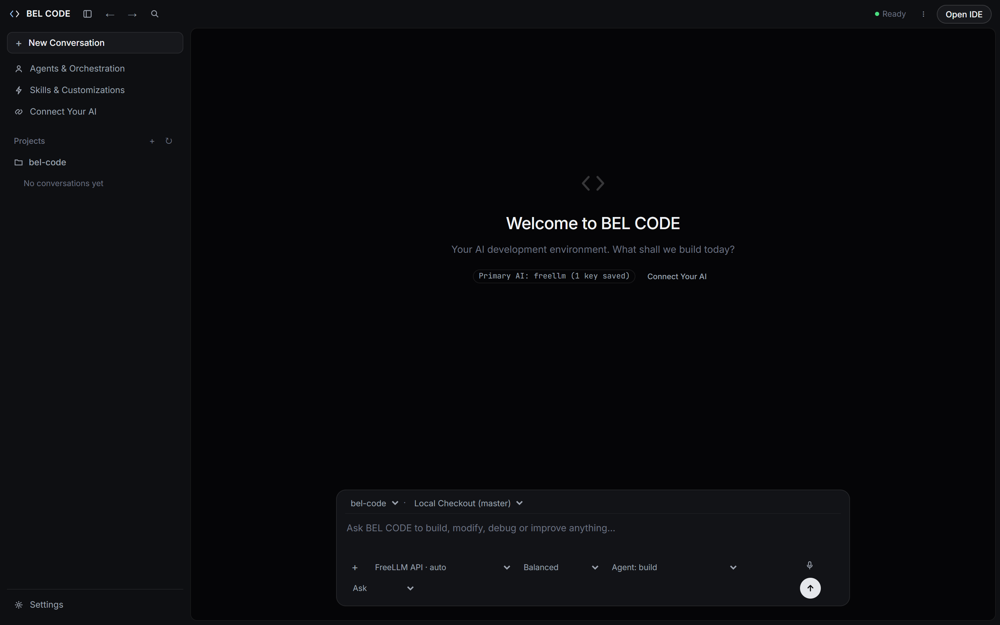
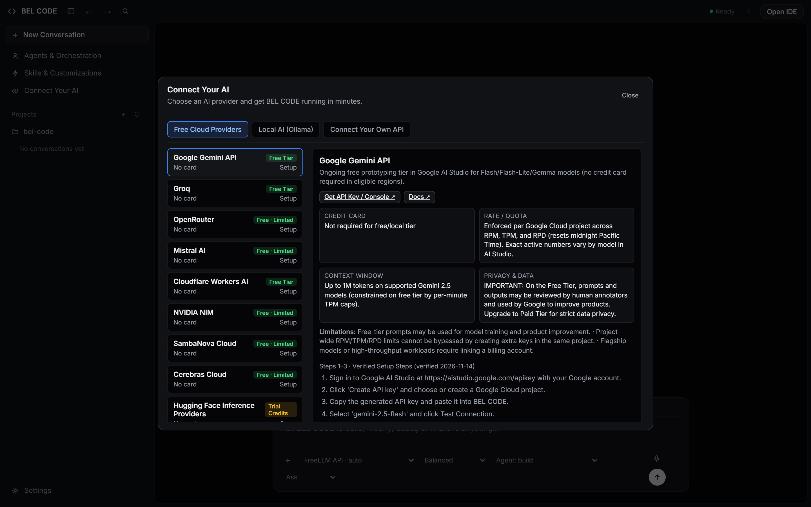
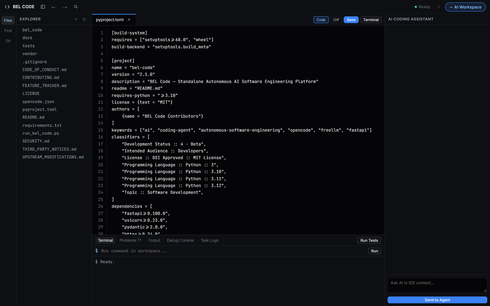
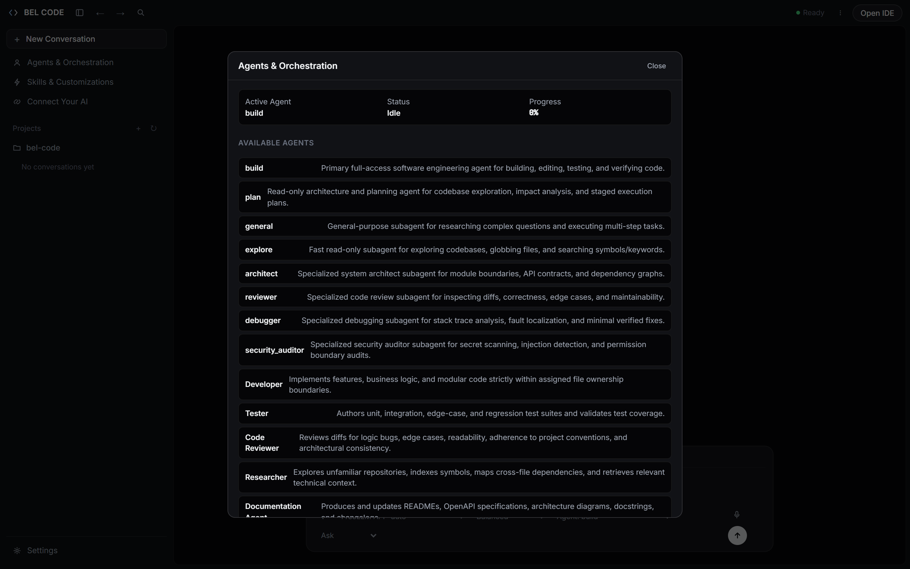
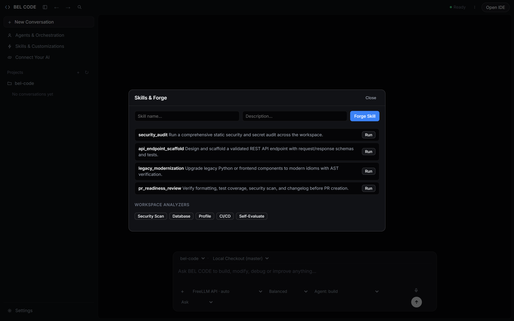
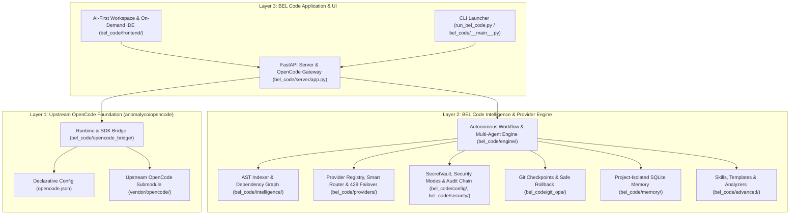

<p align="center">
  
</p>

<h1 align="center">BEL CODE — Open-Source AI-First Software Engineering Environment</h1>

<p align="center">
  A standalone, OpenCode-powered autonomous AI coding workspace and on-demand web IDE with encrypted local credential storage, verified free cloud &amp; local AI onboarding, multi-provider automatic failover, Git checkpointing, and strict execution verification.
</p>

---

## What Makes BEL CODE Different

- **Free & Local AI First:** Start immediately with verified no-credit-card cloud tiers (**Google Gemini API**, **Groq**, **OpenRouter `openrouter/free`**, **Cloudflare Workers AI**, **Mistral AI**, **NVIDIA NIM**, **SambaNova Cloud**, **Cerebras**) or run 100% offline with **Ollama** — without editing source code.
- **No Silent Paid Escalation:** Free (`$0.00`) providers never silently fail over to paid commercial APIs unless you explicitly enable `allow_expensive_upgrade` within configured USD budget caps.
- **Encrypted Local Credential Vault (`SecretVault`):** Keys saved in the UI are encrypted locally in `~/.bel_code/vault.enc` (PBKDF2-HMAC-SHA256 + Encrypt-then-MAC, optional OS keyring) and automatically redacted (`***REDACTED***`) in API responses, terminal logs, and error messages.
- **Clean 3-Layer OpenCode Architecture:** Built on top of the open-source **[OpenCode](https://github.com/anomalyco/opencode)** foundation (`vendor/opencode/`, MIT License) while keeping all BEL CODE intelligence, routing, security, and UI layers strictly outside `vendor/opencode/`.
- **Strict Execution Verification:** Engineering tasks and benchmarks mark work `verified=True` only when actual command execution exits with code `0`, paired with non-destructive Git checkpoints that preserve uncommitted user files on rollback.

---

## Screenshots

| AI-First Workspace | Guided "Connect Your AI" Wizard |
| :---: | :---: |
|  |  |

| On-Demand Integrated IDE Mode | Agents & Orchestration |
| :---: | :---: |
|  |  |

<p align="center">
  
</p>

---

## Key Capabilities & Feature Overview

### Implemented Capabilities (`v2.1.0`)
- **AI-First Workspace & On-Demand IDE (`bel_code/frontend/`):**
  - Clean conversation canvas with floating composer, project/environment selector, file/diff/problems attachments, model/reasoning/agent/permission selectors, and inline human approval banner.
  - One-click **Open IDE** mode with File Explorer, Search, Git Source Control, tabbed Code & Unified Diff editor, Bottom Panel (`Terminal`, `Problems`, `Output`, `Debug Console`, `Task Logs`), and docked AI Assistant.
- **Multi-Provider Routing & Failover (`bel_code/providers/`):**
  - 14+ built-in providers (`gemini`, `groq`, `openrouter`, `mistral`, `cloudflare`, `nvidia`, `sambanova`, `cerebras`, `huggingface`, `github_models`, `ollama`, `freellm`, `tokenharbor`, `openai`, `anthropic`) plus any custom OpenAI-compatible or Anthropic-compatible gateway (`POST /api/providers/custom`).
  - Dynamic model discovery (`GET /api/providers/{provider_id}/models`), multi-account key labels (`default`, `personal`, `work`), HTTP 429 temporary exponential backoff vs. permanent daily-quota failover, and per-task/per-project/global USD spend caps (`BudgetConfig`).
- **Autonomous Engineering & Multi-Agent Engine (`bel_code/engine/`):**
  - 7-stage engineering lifecycle (`understand` -> `plan` -> `implement` -> `test` -> `repair` -> `review` -> `deliver`) with persistent session resume.
  - OpenCode built-in agents (`build`, `plan`, `general`, `explore`), `opencode.json` subagents (`architect`, `reviewer`, `debugger`, `security_auditor`), and 9 specialized roles (`MultiAgentCoordinator`) with disjoint file ownership locks.
  - 10 real-execution acceptance benchmarks (`python run_bel_code.py --benchmark all`).
- **Repository Intelligence, Git & Memory (`bel_code/intelligence/`, `bel_code/git_ops/`, `bel_code/memory/`):**
  - Python AST symbol indexer, cross-file dependency graphs, Mermaid architecture map generation, and code health checks.
  - Non-destructive Git checkpoints, safe rollback preserving uncommitted user files, PR diff reviewer, and project-isolated SQLite engineering memory with secret/PII sanitization.
- **Security Governance & Controls (`bel_code/security/`, `bel_code/tools/`):**
  - `ask`, `supervised`, and `autonomous` permission modes, workspace path confinement, command risk classification, human approval queue, indirect prompt-injection scanner, and SHA-256 hash-chained audit log.
- **Skills, Forge & Workspace Analyzers (`bel_code/advanced/`):**
  - Built-in reusable skills, custom skill forging (`POST /api/advanced/skills`), 5 scaffolding templates (`fastapi_service`, `python_cli`, `react_component`, `filesystem_mcp`, `postgres_mcp`), lifecycle hooks, MCP server registry, SAST security scan, DB schema analyzer, OpenAPI 3.0 generator, profiler, CI/CD generator, and self-evaluation.

---

## Architecture Overview

BEL CODE enforces a strict 3-layer separation:



For module-level details, see [docs/ARCHITECTURE.md](docs/ARCHITECTURE.md) and [UPSTREAM_MODIFICATIONS.md](UPSTREAM_MODIFICATIONS.md).

---

## Technology Stack

- **Backend & API:** Python 3.10+, FastAPI, Uvicorn, Pydantic v2, HTTPX
- **Frontend:** Vanilla HTML5, CSS3, JavaScript (no external frontend build step required)
- **Foundation Layer:** Upstream [OpenCode](https://github.com/anomalyco/opencode) v2.3.0 (`vendor/opencode/`) + optional Node.js 18+ ESM SDK bridge (`bel_code/opencode_bridge/sdk_adapter.mjs`)
- **Storage & Security:** SQLite (`memory.db`), PBKDF2-HMAC-SHA256 + Encrypt-then-MAC (`SecretVault`), optional `keyring`, SHA-256 hash-chained audit logs
- **Testing:** `pytest` (unit, integration, security, UI structure, and benchmark tests)

---

## System Requirements

- **OS:** Windows 10/11, macOS, or Linux
- **Python:** 3.10 or newer (`python --version`)
- **Git:** 2.30 or newer (`git --version`)
- **Optional:** Node.js 18+ (for `sdk_adapter.mjs`) and [Ollama](https://ollama.com/) (8 GB+ RAM for local models)

---

## Installation

```bash
git clone --recurse-submodules https://github.com/Avyansh-AI/BEL-CODE.git
cd BEL-CODE
python -m venv .venv
# Linux/macOS: source .venv/bin/activate
# Windows:     .\.venv\Scripts\Activate.ps1
pip install -r requirements.txt
```

If you already cloned without `--recurse-submodules`:

```bash
git submodule update --init --recursive
```

For editable package installation with dev tools (`pytest`, `playwright`, `keyring`), run `pip install -e ".[dev]"`. See [docs/INSTALLATION.md](docs/INSTALLATION.md) for full details.

---

## First-Time Setup & Launch

Start the BEL CODE web server:

```bash
python run_bel_code.py --port 8765
```

Open **`http://127.0.0.1:8765`** in your browser. On first launch, choose any of three onboarding paths on the Welcome screen:

1. **Connect a Free Cloud AI Provider** — Opens the **Connect Your AI** guided wizard with official console links, verified free-tier limits, privacy disclosures, and live connection testing.
2. **Connect Your Own API** — Register any OpenAI-compatible or Anthropic-compatible gateway, proxy (LiteLLM, vLLM, LM Studio), or commercial key.
3. **Use a Local AI Model** — Connect **Ollama** (`http://localhost:11434/v1`) with zero API keys required.

---

## Free AI Provider Configuration

BEL CODE includes a curated, transparent provider registry ([bel_code/providers/registry.json](bel_code/providers/registry.json)) that distinguishes ongoing free tiers, daily-limited tiers, monthly trial credits, and local models:

| Provider | Tier Type | Card Required? | Setup Link |
| :--- | :--- | :--- | :--- |
| **Google Gemini API** | Ongoing free prototyping tier | No | [Google AI Studio](https://aistudio.google.com/apikey) |
| **Groq** | Ongoing free tier (RPM/TPM capped) | No | [Groq Console](https://console.groq.com/keys) |
| **OpenRouter (`openrouter/free`)** | Free tier (20 RPM / 50 RPD unfunded) | No | [OpenRouter Keys](https://openrouter.ai/settings/keys) |
| **Cloudflare Workers AI** | 10,000 free Neurons/day | No | [Cloudflare Dashboard](https://dash.cloudflare.com/) |
| **Mistral AI (Free Mode)** | Free experimentation tier (~1 RPS) | No | [Mistral Console](https://console.mistral.ai/api-keys/) |
| **NVIDIA NIM** | Free prototyping API | No | [NVIDIA Build](https://build.nvidia.com/settings/api-keys) |
| **SambaNova Cloud** | Free evaluation tier | No | [SambaNova Cloud](https://cloud.sambanova.ai/apis) |
| **Cerebras Cloud** | Free developer tier | No | [Cerebras Cloud](https://cloud.cerebras.ai/) |

See [docs/FREE_AI_PROVIDERS.md](docs/FREE_AI_PROVIDERS.md) for exact limits, privacy notes, and multi-provider failover recommendations.

---

## Local AI Configuration (Ollama & Self-Hosted)

Run 100% locally with **Ollama**:

```bash
ollama serve
ollama pull qwen2.5-coder:7b
```

Then select **Use a Local AI Model** on the Welcome screen (defaults to `http://localhost:11434/v1`, no API key needed), or set `OLLAMA_HOST` in `.env`. See [docs/LOCAL_AI.md](docs/LOCAL_AI.md) for hardware sizing and LM Studio / vLLM / `llama.cpp` setup.

---

## How to Use BEL CODE

### Web Workspace & IDE
1. Open a project folder via **Projects -> `+`** in the left sidebar.
2. Select your model, reasoning level (`Balanced`, `Deep Reasoning`, `Fast`), agent (`build`, `plan`, `debug`, `review`), and safety mode (`Ask`, `Supervised`, `Autonomous`) in the composer.
3. Submit a coding task, inspect diffs or approve sensitive actions inline, and click **Open IDE** at the top right whenever you want the full multi-pane editor, diff viewer, and terminal.

### CLI Usage

```bash
python run_bel_code.py --port 8765 --workspace /path/to/repo --mode supervised
python run_bel_code.py --scan --workspace /path/to/repo
python run_bel_code.py --task "Add unit tests for billing.py" --workspace /path/to/repo
python run_bel_code.py --benchmark all
```

---

## Configuration Options

- **UI Wizard & Settings:** Stored encrypted in `~/.bel_code/vault.enc` (secrets) and `~/.bel_code/config.json` (non-secret preferences).
- **Environment Variables (`.env`):** Copy [`.env.example`](.env.example) to `.env` (never commit `.env`) and populate keys such as `GEMINI_API_KEY`, `GROQ_API_KEY`, `OPENROUTER_API_KEY`, `CLOUDFLARE_ACCOUNT_ID` + `CLOUDFLARE_API_TOKEN`, `OLLAMA_HOST`, or `FREELLM_API_KEY`.
- **`opencode.json`:** Declarative OpenCode provider, agent, and permission config using `{env:...}` placeholders only.

See [docs/API_CONFIGURATION.md](docs/API_CONFIGURATION.md) for routing roles, custom endpoints, and resolution order.

---

## Documentation Index

| Guide | Description |
| :--- | :--- |
| [Getting Started](docs/GETTING_STARTED.md) | Quick setup from clone to first task |
| [Installation Guide](docs/INSTALLATION.md) | OS-specific install, submodules, and verification |
| [Free AI Providers](docs/FREE_AI_PROVIDERS.md) | Verified comparison of free cloud tiers and privacy notes |
| [API Configuration](docs/API_CONFIGURATION.md) | UI wizard, `.env`, custom endpoints, and 429 failover |
| [Local AI Setup](docs/LOCAL_AI.md) | Offline setup with Ollama, LM Studio, vLLM, and FreeLLMAPI |
| [Architecture Overview](docs/ARCHITECTURE.md) | 3-layer architecture and module responsibilities |
| [Agents & Workflow](docs/AGENTS.md) | OpenCode agents, 9 specialized roles, file locks, and 7-stage lifecycle |
| [Skills & Skill Forging](docs/SKILL_FORGING.md) | Built-in skills, custom skill forging, templates, and analyzers |
| [Troubleshooting](docs/TROUBLESHOOTING.md) | Fixes for 401/403, 429 limits, Cloudflare IDs, and Ollama errors |
| [Privacy & Security](docs/PRIVACY_AND_SECURITY.md) | `SecretVault` encryption, redaction, and telemetry guarantees |

---

## Troubleshooting

- **`401` / `403` errors:** Verify key formatting and required token scopes (e.g., `models:read` for GitHub Models).
- **`429` rate limits:** Configure a Secondary Failover provider (for example Gemini + Groq + Cerebras) so BEL CODE routes around temporary or daily caps automatically.
- **`localhost:11434` refused:** Start `ollama serve` and confirm a model is pulled (`ollama list`).
- **`localhost:31415` refused:** `freellm` expects a separate local FreeLLMAPI gateway; switch Primary AI in **Connect Your AI** to a cloud provider or Ollama if you are not running that gateway.

See [docs/TROUBLESHOOTING.md](docs/TROUBLESHOOTING.md) for detailed fixes.

---

## Contributing

Contributions are welcome! Please read:
- [CONTRIBUTING.md](CONTRIBUTING.md) — Development setup, 3-layer boundary rules, and PR checklist
- [CODE_OF_CONDUCT.md](CODE_OF_CONDUCT.md) — Community standards
- [CHANGELOG.md](CHANGELOG.md) — Release history

Run the automated test suite before opening a PR:

```bash
pytest -v
```

---

## Security Reporting

Please **do not** open public GitHub issues for security vulnerabilities or leaked secrets. Follow [SECURITY.md](SECURITY.md) to report vulnerabilities privately via GitHub Security Advisories.

---

## License & Upstream Attribution

- Released under the **[MIT License](LICENSE)**.
- Layer 1 builds on **[OpenCode](https://github.com/anomalyco/opencode)** (MIT License, Copyright (c) 2025 opencode). See [vendor/opencode/LICENSE](vendor/opencode/LICENSE), [THIRD_PARTY_NOTICES.md](THIRD_PARTY_NOTICES.md), and [UPSTREAM_MODIFICATIONS.md](UPSTREAM_MODIFICATIONS.md).

---

## Project Roadmap

### Implemented (`v2.1.0`)
- 3-layer OpenCode-powered architecture and REST/SSE bridge
- AI-First Workspace + toggleable On-Demand IDE
- Encrypted `SecretVault` + `.env` loader + automatic secret redaction
- 14+ provider adapters, custom OpenAI/Anthropic gateway UI, and 429 failover
- 7-stage autonomous workflow, 9-role multi-agent file locks, Git checkpoints, SQLite memory, and skills/analyzers

### Planned
- Real-time collaborative multi-user workspaces
- Native desktop wrapper (Electron / Tauri packaging)
- Expanded interactive Playwright visual E2E suite in CI
- Live streaming token-by-token WebSocket/SSE bridge directly into the composer timeline for all cloud adapters
