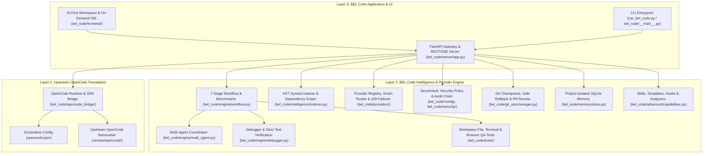

# Architecture Overview

**BEL CODE** is structured as a standalone **3-Layer OpenCode-Powered Platform** that keeps upstream OpenCode source code untouched while providing BEL CODE's AI-first workspace, on-demand IDE, provider routing, encrypted secret storage, and autonomous engineering engine.

---

## 1. Three-Layer Design

---

## 2. Layer Breakdown

### Layer 1 — OpenCode Foundation
- **`vendor/opencode/`**: Unmodified submodule clone of `anomalyco/opencode` (v2.3.0, MIT License, commit `cbe71595e1f370ff91b3081872b96bbe56519c41`), containing `packages/core`, `packages/server`, `packages/cli`, and `packages/sdk`.
- **`opencode.json`**: Declarative configuration conforming to `https://opencode.ai/config.json`. References credentials strictly via `{env:...}` placeholders (`{env:FREELLM_API_KEY}`, `{env:TOKENHARBOR_API_KEY}`, `{env:GROQ_API_KEY}`), never raw keys.
- **`bel_code/opencode_bridge/`**:
  - `runtime.py` (`OpenCodeRuntimeManager`): Inspects `vendor/opencode`, synchronizes `opencode.json` without writing plaintext secrets, injects decrypted keys into runtime memory, and implements OpenCode-compatible HTTP/SSE session, diff, revert, and permission endpoints.
  - `client.py` (`OpenCodeClient`): Python client covering OpenCode server routes and namespaces.
  - `sdk_adapter.mjs`: Node/ESM bridge wrapping `@opencode/sdk` routes.

### Layer 2 — BEL Code Intelligence & Engine
- **`bel_code/config/settings.py`**: `SecretVault` (PBKDF2-HMAC-SHA256 + Encrypt-then-MAC `~/.bel_code/vault.enc` with optional OS keyring), `BudgetConfig` (per-task, per-project, global USD caps with hard-stop), and `SettingsManager`.
- **`bel_code/providers/`**: Verified provider catalog (`registry.json`), `FreeLLMAdapter` (`freellm.py`), 12+ built-in adapters + custom OpenAI/Anthropic endpoints (`adapters.py`), and `ProviderManager` (`router.py`) with task-type routing, HTTP 429 exponential backoff vs permanent-quota failover, and no-silent-paid-escalation guardrails.
- **`bel_code/intelligence/indexer.py`**: Repository scanner, Python AST symbol extraction, cross-file dependency graph, Mermaid diagram generation, context retrieval, and code health analysis.
- **`bel_code/engine/`**: `AutonomousWorkflowEngine` (7-stage lifecycle + 10 acceptance benchmarks), `MultiAgentCoordinator` (9 roles + file ownership locks), and `TestAndDebugEngine` (real exit-code verification and stack trace fault localization).
- **`bel_code/security/policy.py`**: Workspace path confinement, `ask`/`supervised`/`autonomous` security modes, command risk classification, human approval queue, indirect prompt-injection scanner, and SHA-256 hash-chained audit log.
- **`bel_code/tools/`**: Safe `FileSystemTools`, secret-redacting `TerminalExecutor`, and `BrowserQATester` (responsive viewport and accessibility checks).
- **`bel_code/git_ops/manager.py`**: Branch/diff status, non-destructive checkpoints, safe rollback preserving uncommitted user files, PR diff reviewer, and change register.
- **`bel_code/memory/store.py`**: Project-isolated SQLite store (`~/.bel_code/` or workspace `.bel_code/memory/memory.db`) with PII/secret sanitization and session recovery.
- **`bel_code/advanced/capabilities.py`**: Reusable skills, project scaffolding templates, lifecycle hooks, MCP registry, SAST scan, migration helper, OpenAPI 3.0 generator, DB schema analyzer, profiler, CI/CD generator, image-to-UI studio, and measured self-evaluation.

### Layer 3 — Application & Interface
- **`bel_code/server/app.py`**: FastAPI server serving both OpenCode protocol routes (`/api/opencode/*`, `/global/health`, `/session/*`, `/config/*`, `/agent`, `/file/*`, `/find/*`, `/event`) and BEL Code workspace/intelligence routes (`/api/*`).
- **`bel_code/frontend/`**: Vanilla HTML/CSS/JS workspace (`index.html`, `styles.css`, `app.js`) providing an AI-first conversation workspace and an on-demand IDE mode (Explorer, Code/Diff Editor, Terminal, Problems, Output, Debug Console, Task Logs, and docked AI Assistant).
- **`run_bel_code.py` & `bel_code/__main__.py`**: Standalone CLI supporting `--host`, `--port`, `--workspace`, `--mode`, `--task`, `--benchmark`, and `--scan`.

---

## 3. Upstream Modification Boundary

All BEL CODE features live outside `vendor/opencode/`. See [UPSTREAM_MODIFICATIONS.md](../UPSTREAM_MODIFICATIONS.md) and [THIRD_PARTY_NOTICES.md](../THIRD_PARTY_NOTICES.md) for boundary rules and license preservation.
